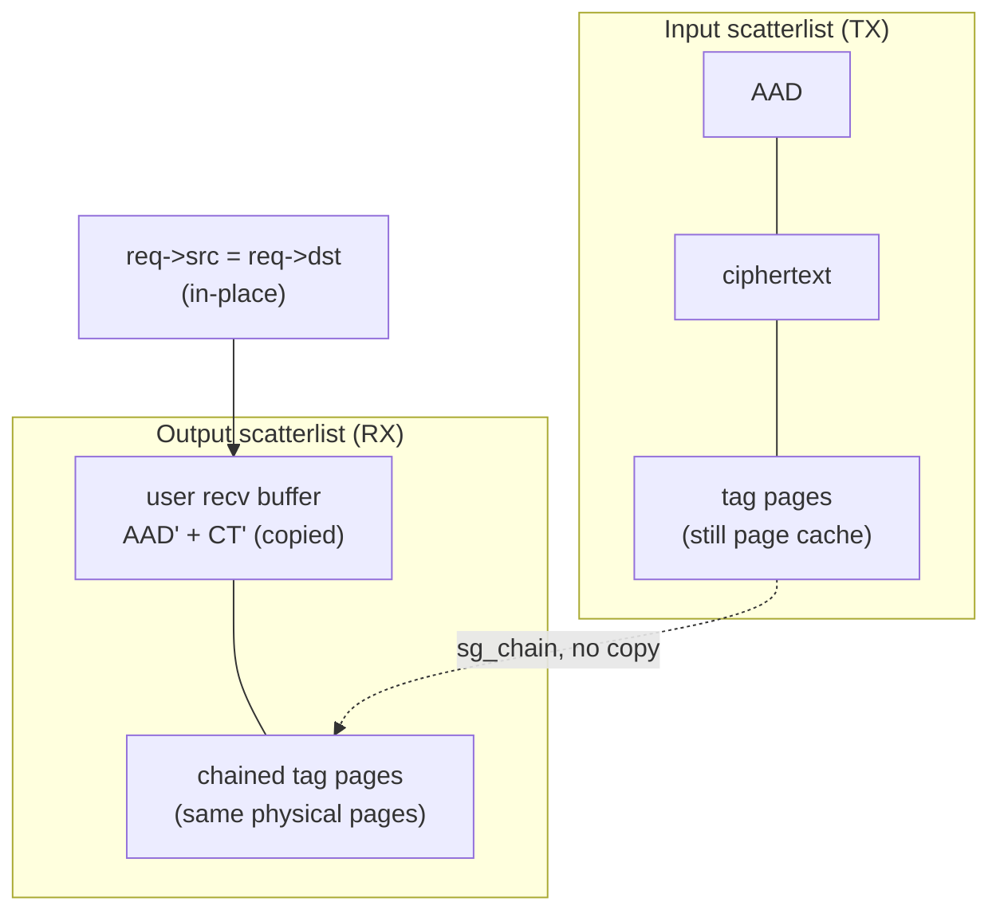
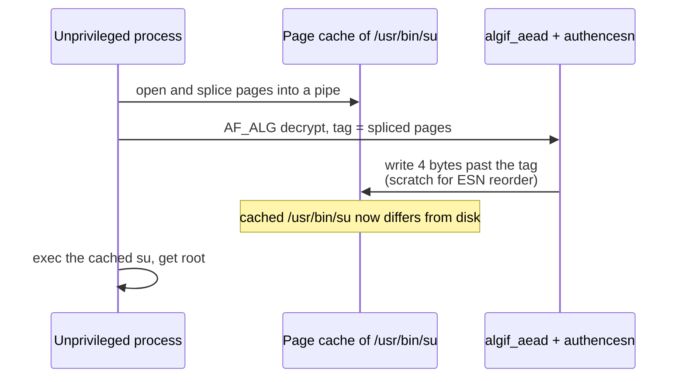

Most local privilege escalations I read need a race window, a heap spray, or a kernel-version-specific offset. Copy Fail needs none of those. Theori published it on 29 April 2026 as CVE-2026-31431, CVSS 7.8. A 732-byte Python script, they said, rooted every mainstream distribution shipping a kernel built since 2017. CISA put it on KEV on 1 May.

I am writing this as the origin story of a bug *class*, not as a one-off. V12 later called [Fragnesia](/articles/fragnesia-cve-2026-46300/) (CVE-2026-46300) "copyfail 3.0". Same idea: write into the page cache of a readable file, never touch the disk, escalate. Understanding Copy Fail makes Fragnesia's IR playbook make sense.

## A file that is not the file

When Linux opens a file, it keeps recently read pages in a cache called the **page cache**. Later reads and even `execve()` of a binary often hit that cache, not the disk. That is normal and fast.

`splice()` is a system call that moves data between file descriptors and pipes without copying bytes. The pages that land in the pipe are *references* to the page cache of the file, not duplicates. Point those references at the wrong place and you can change what the rest of the system believes the file contains, while `sha256sum` of the on-disk file still matches.

That mismatch is the forensic signature of this whole family.

## How the memory ends up writable

`AF_ALG` is a socket family that exposes the kernel's crypto API to unprivileged userspace. You open a socket, bind an algorithm name, send data, get a result. No special privileges.

AEAD means Authenticated Encryption with Associated Data: ciphertext plus a short authentication tag, with some extra authenticated bytes (AAD) on the side. For decryption, the kernel's `algif_aead` code used to set things up *in place*. Same scatterlist (a list of memory pages the crypto engine walks) as both input and output.

Theori's write-up draws the fatal step. AAD and ciphertext are really copied into a receive buffer. The authentication tag is not. Its scatterlist entries, still pointing at page-cache pages the caller just spliced in, get chained onto the end of the output list with `sg_chain()`:



Page-cache pages of a readable file now sit inside a *writable* destination scatterlist. The design assumed every AEAD algorithm would only write inside its documented output region. One of them did not.

## The four-byte scratch write

`authencesn` is an AEAD wrapper IPsec uses for Extended Sequence Numbers. It needs to rearrange eight AAD bytes before hashing. It does that by using the caller's destination buffer as scratch space. Three `scatterwalk_map_and_copy` calls later, the third one writes four attacker-controlled bytes at offset `assoclen + cryptlen`, past the tag.

That offset lands inside the chained tag pages. Those pages are the page cache of whatever file you spliced. One controlled four-byte write per round trip. Repeat on carefully chosen offsets of `/usr/bin/su` (or another setuid binary) and the cached copy becomes a different ELF. Run `su`. You are root. Reboot and the disk file is still the original. The change was never persistent, but the root shell was real.



Educational shape only, no offsets:

```text
open AF_ALG socket, bind "authencesn(...)" or equivalent AEAD name
splice(readable_setuid_file) -> pipe -> AF_ALG socket   # tag region
send AAD that chooses the 4 bytes written past the tag
recvmsg drains the operation
repeat until the cached binary is the shape you want
exec the path (execve uses the cache)
```

I am not publishing a working script here. Theori's public PoC lives at their GitHub for people who own the systems they test.

## Affected range and the quiet patch

Introduced by the 2017 in-place optimisation (commit `72548b093ee3`). Mainline fix `a664bf3d603d` ("crypto: algif_aead - Revert to operating out-of-place") landed 1 April 2026. Public disclosure 29 April. Fixed packages later shipped in 5.10.254, 5.15.204, 6.1.170, 6.6.137, 6.12.85, 6.18.22, 6.19.12 and 7.0 among others. Ubuntu 26.04 was already outside the window. CERT-EU's day-after advisory noted vendor packages were still pending across major distros, and pushed the interim mitigation hard, especially on Kubernetes nodes and CI runners.


Shared hosts, CI runners that execute untrusted PR code, Kubernetes nodes and any multi-tenant box where one unprivileged user can open AF_ALG. A single-user laptop is lower urgency for this bug alone. Chained with a web RCE, every host becomes interesting.



When Copy Fail dropped we tested it across our own org right away. Fortunately no important machines came back vulnerable. The only hits were a few VMs with limited network access or fully isolated, and we patched those straight away.


## Same family, later chapters

| Year | Name | CVE | Primitive |
|---|---|---|---|
| 2022 | Dirty Pipe | CVE-2022-0847 | splice into a pipe, overwrite cache |
| 2026-04 | Copy Fail | CVE-2026-31431 | AF_ALG + splice, 4-byte cache write |
| 2026-05 | Fragnesia | CVE-2026-46300 | espintcp + coalesce flag drop, chosen-byte cache write |

V12 named Fragnesia "copyfail 3.0" for a reason. The page-cache-vs-disk check you build for one of them works for the others. When [Fragnesia](/articles/fragnesia-cve-2026-46300/) hit KEV in October after being chained with [PHP2Shell](/articles/php2shell-cve-2026-109618-109619/), that check was already the right first move.

## Detection the way I would write it

Do not reboot first. Do not `echo 3 > /proc/sys/vm/drop_caches`. Either wipe clears the only evidence.

```text
CHECK page_cache_vs_disk
  FOR each of /usr/bin/su, /usr/bin/sudo, /etc/pam.d/su, /etc/pam.d/su-l:
    H1 = sha256 of normal read
    H2 = sha256 of direct disk read (O_DIRECT / dd iflag=direct)
    IF H1 != H2: ALERT  "page cache diverged from disk"
    # this is the family signature

HUNT af_alg_from_odd_process
  WHEN socket(AF_ALG, ...) succeeds
   AND process is not a known crypto helper
  -> MEDIUM
  (auditd / eBPF / seccomp logs)

HUNT setuid_flipped_without_package_change
  WHEN rpm -V / dpkg --verify flags su, sudo, pam
    OR file mtime of those paths jumps without a package transaction
  -> HIGH, then run the cache-vs-disk check before reboot
```

Interim mitigations that cost almost nothing on normal hosts: `install algif_aead /bin/false` in modprobe, or `initcall_blacklist=algif_aead_init` where it is built in (RHEL). CERT-EU confirmed this does not break dm-crypt, kTLS, IPsec/XFRM, OpenSSL defaults or SSH. Block `AF_ALG` with seccomp in containers and CI regardless of patch status. Check exposure with `lsof | grep AF_ALG`.



```text
req->src = req->dst = combined SGL
tag pages = page cache references
authencesn writes past the tag
-> cache corrupted
```


```text
separate src and dst scatterlists
kernel buffer for the destination
AEAD result copied back to userspace
page cache never writable from AF_ALG
```



## Closing the loop

Copy Fail is the cleanest teaching example I have for "the kernel lied about a file". Four bytes, no race, nine years. The IR habit it teaches is more valuable than the bug itself: when a host looks rooted and the disk hashes are clean, check the cache before you tidy up. That habit paid off again when Fragnesia showed up in the wild.

## Sources

- Theori advisory and demo: https://copy.fail
- Theori PoC repository: https://github.com/theori-io/copy-fail-CVE-2026-31431
- Xint / Theori technical write-up: https://xint.io/blog/copy-fail-linux-distributions
- CERT-EU advisory 2026-005: https://www.cert.europa.eu/publications/security-advisories/2026-005/
- NVD: https://nvd.nist.gov/vuln/detail/cve-2026-31431
- Red Hat RHSB-2026-002: https://access.redhat.com/security/vulnerabilities/RHSB-2026-002
- Fix discussion (oss-security / seclists): https://seclists.org/oss-sec/2026/q2/281
