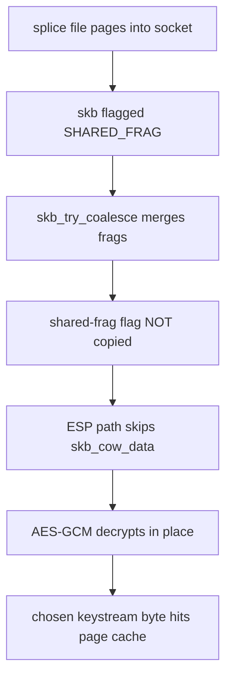
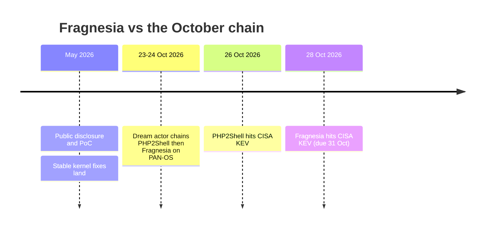


If you suspect Fragnesia, **do not reboot** and do not run `echo 3 > /proc/sys/vm/drop_caches` first. That wipes the only reliable evidence.


On 28 October 2026 CISA added CVE-2026-46300 to the Known Exploited Vulnerabilities catalog. The bug had been public since May. What changed in October is that attackers chained it with PHP2Shell and rooted about 25 Palo Alto Networks PAN-OS boxes (24 firewalls and one management server) across the US, Japan, Taiwan and Korea. Unit 42 tracks that activity as CL-UNK-1280. Dream Research published the forensic write-up.

I am writing this as the incident-response half of the PHP2Shell story. The kernel bug is a local privilege escalation. It needs code already running on the host. PHP2Shell is how that code got there.

## Page cache, in one paragraph

Linux keeps recently read file bytes in RAM so the next read is fast. That RAM copy is the **page cache**. Normal tools like `cat` and `sha256sum` read through the cache. A direct disk read (the `O_DIRECT` flag) bypasses it. Fragnesia's whole trick is: change the cached copy of a file, leave the bytes on disk alone. After a reboot the cache is gone and the host looks clean.

## How a shared fragment becomes a chosen write



More slowly:

1. Linux can carry IPsec ESP inside a TCP stream (`espintcp`). ESP is the encrypted IPsec packet format. A **nonce** here is the public IV that picks which keystream the cipher uses.
2. When you `splice()` file data into a socket, the socket buffer (an `skb`) holds *references* to the file's page-cache pages and sets `SKBFL_SHARED_FRAG` ("do not write into me").
3. `skb_try_coalesce()` merged those fragments into another skb **without copying the shared-frag flag**.
4. The ESP receive path checks `skb_has_shared_frag()`, sees false, skips the copy-on-write step, and decrypts AES-GCM **in place** over the page-cache pages.
5. Because the attacker picks the IV/nonce, they pick the keystream byte that gets XORed in. One chosen byte per trigger, into the cached copy of any readable file. No race to win.

The public V12 PoC overwrites the first 192 bytes of `/usr/bin/su` in cache with a small setuid shell stub. The Dream actor rewrote `/etc/pam.d/su` so it loads `pam_permit.so`, which means `su root` accepts any password. **The disk is never modified.**


V12 literally called Fragnesia "copyfail 3.0". CVE-2026-31431 (Copy Fail, April/May 2026) was an earlier page-cache write via `algif_aead`. Same IR playbook.


## The timeline that matters for responders



CVSS is 7.8 from Red Hat (EGI SVG rates it 8.8). Fixed kernels include 7.0.10, 6.18.33, 6.12.91, 6.6.141, 6.1.174 and 5.15.208, with matching Debian/Ubuntu/Alma builds. Exploitation usually needs permission to create user namespaces, unless it is chained with another bug. Hosts that block the `esp4` / `esp6` / `rxrpc` modules are not reachable by this path.

One caveat from VulnCheck on netdev (28 May 2026): a public PoC variant uses the `skb_segment()` path, which the original fix did not cover. I have not seen a separate CVE for that variant. Do not assume every host is fully closed.


When Fragnesia came out we checked our entire infrastructure the same day. We were already safe. Our devices were covered by older updates and custom patches, so none of them were exposed to this path.


## The check that survives the lie

Compare the cached file to the disk. A mismatch is the signature of this bug class.

```bash
# cached view
sha256sum /usr/bin/su /etc/pam.d/su

# disk view (bypasses page cache)
dd if=/usr/bin/su iflag=direct bs=4096 2>/dev/null | sha256sum
dd if=/etc/pam.d/su iflag=direct bs=4096 2>/dev/null | sha256sum
```

Also useful before cleanup:

```bash
grep pam_permit /etc/pam.d/su*
rpm -V pam util-linux shadow-utils 2>/dev/null
dpkg --verify login passwd 2>/dev/null
lsmod | grep -E 'esp4|esp6|rxrpc'
```



```
# compromised cache, clean disk
sha256sum /etc/pam.d/su
# -> aaaa... (pam_permit planted)

dd if=/etc/pam.d/su iflag=direct | sha256sum
# -> bbbb... (vendor file)
```


```
# healthy host
sha256sum /etc/pam.d/su
# -> bbbb...

dd if=/etc/pam.d/su iflag=direct | sha256sum
# -> bbbb...  (match)
```



## What I would collect, in order

1. Copy the cached suspects (`/usr/bin/su`, `/usr/bin/sudo`, `/etc/pam.d/su`, `/etc/pam.d/su-l`) out of memory first.
2. `last`, `journalctl _COMM=su`, full process list, `lsmod`.
3. Hunt for a web-server user (`nobody`, `www-data`) spawning `su`, and for unprivileged processes doing `splice` plus `setsockopt(TCP_ULP, "espintcp")` via auditd or eBPF.
4. On the PAN-OS Dream victims: systemd units and `rc.local` launching from `/usr/local/lib/.panops/`, a 103-byte PHP webshell at `/unauth/php/change_password.php`, and an 8-port reverse SSH tunnel.

Interim mitigation when you cannot patch yet: `modprobe install esp4 /bin/false` (same for `esp6` and `rxrpc`). That breaks IPsec on that host, so weigh it.

Pseudo-logic for the SIEM:

```
(file_hash_cache(/etc/pam.d/su) != file_hash_direct(/etc/pam.d/su))
OR (process_user in (nobody, www-data, apache) AND process_name = su)
OR (lsmod_has(esp4) AND host_role != ipsec_gateway)
```

## Sources

- oss-security disclosure: https://www.openwall.com/lists/oss-security/2026/05/13/3
- CISA KEV add: https://www.cisa.gov/news-events/alerts/2026/10/28/cisa-adds-two-known-exploited-vulnerabilities-catalog
- Dream Research: https://dreamgroup.com/blog/chained-php2shell-exploit-roots-25-servers
- BleepingComputer: https://www.bleepingcomputer.com/news/security/cisa-warns-of-fragnesia-linux-flaw-chained-in-php2shell-attacks/
- HOL IR notes: https://hol.org/blog/cve-2026-46300-fragnesia-linux-kernel-cisa-kev-root
- PoC: https://github.com/v12-security/pocs/tree/main/fragnesia
- Variant note: https://lists.openwall.net/netdev/2026/05/28/269
