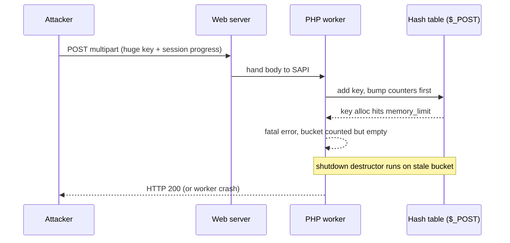
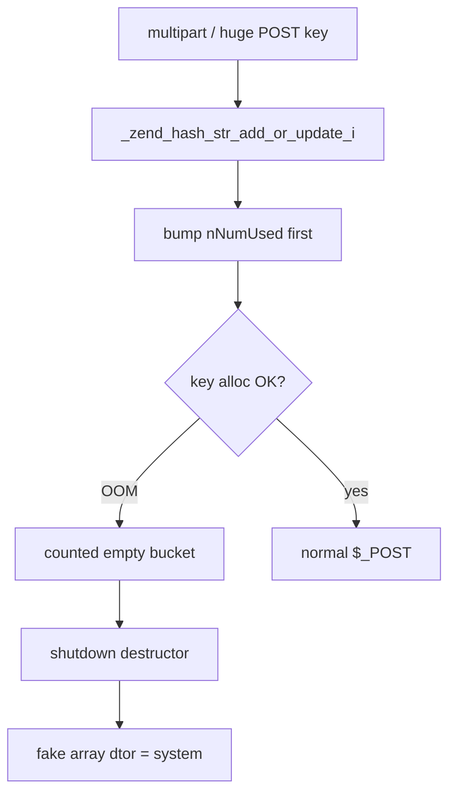

I spend a lot of my week staring at web-facing attack surface for a national CSIRT. When AWS said they had seen probes for the new PHP bugs four days *before* the 21 October 2026 patch, that got my attention. The labels are CVE-2026-109618 and CVE-2026-109619. Researchers call the pair PHP2Shell. Both score CVSS 9.2. Both fire during request parsing, which means your login page, WAF rules aimed at application paths, and most of your input filters never get a vote.

This post is me walking one malicious request the way I would brief a SOC. No working exploit. Just the shape, the bug, and the artefacts.

## The request that never reaches your app

Picture a PHP-FPM worker behind Apache or nginx. A client sends a multipart form. Multipart means the body is chopped into named parts separated by a boundary string. PHP has to build `$_POST`, `$_FILES` and session bookkeeping out of those parts *before* it hands control to `index.php`.



CVE-2026-109618 sits inside `_zend_hash_str_add_or_update_i()`. In plain words, PHP's hash table is the structure behind arrays like `$_POST`. When a new key is added, the function bumps the "used slots" counters **before** it finishes allocating memory for the key string. If that allocation exceeds `memory_limit`, PHP throws a fatal error and leaves a counted but uninitialised bucket. During request shutdown, cleanup walks every counted bucket and destroys it. With the right heap layout, those leftover bytes look like a tiny array whose destructor points at `system()`. The shell runs. Application code never started.



CVE-2026-109619 is the sibling. A fatal error can leave worker-global state alive (upload-progress / session bookkeeping, and on PHP 8.5 also fatal-error backtraces). The next request on the same worker reuses that stale state. One request sets the trap. The next request springs it.


Both bugs live in the request parser. Auth middleware in the framework is too late.


## Annotated request shape (lab only)

Public write-ups (Datadog Security Labs, the PHP Foundation post, open labs) show a common carrier: a multipart form that forces session upload-progress bookkeeping, then a key so large it trips `memory_limit`. The block below is an **illustrative shape**. Offsets, heap grooming and ASLR leaks are deliberately left out. Do not paste this at a production host.

```http
POST / HTTP/1.1
Host: lab.example
Content-Type: multipart/form-data; boundary=----EDGE
Cookie: PHPSESSID=labsession01

------EDGE
Content-Disposition: form-data; name="PHP_SESSION_UPLOAD_PROGRESS"
# tells PHP to track upload progress into the session

lab
------EDGE
Content-Disposition: form-data; name="file"; filename="x"
Content-Type: application/octet-stream

AAAA
------EDGE
Content-Disposition: form-data; name="<VERY_LONG_NAME>[x]"
# name length chosen to push the key alloc past memory_limit

1
------EDGE--
```

> **Note.** A shorter cousin of the same idea is a query string like `=<bin>&a=1&<huge name>[x]=1`. Same hash-table path, different carrier.

## What the patch changed



```
alloc key
  -> bump nNumUsed / nNumOfElements
  -> allocate key string
  -> on OOM: fatal, bucket still counted
```


```
soft memory limit: defer error to a safe point
hard memory limit: _exit(137), abandon the worker
no counted-but-empty bucket left for shutdown
```



Fixed releases: **8.2.35**, **8.3.36**, **8.4.27**, **8.5.12**. Older unsupported branches got source backports. Every common SAPI is in scope (`mod_php`, PHP-FPM, `php-cgi`, FrankenPHP, LiteSpeed).

## What I would hunt

As a detection engineer I care about signals that survive even when the worker returns HTTP 200.

| Signal | Where | Why it matters |
|---|---|---|
| `Allowed memory size ... in Unknown on line 0` | PHP error log | Classic OOM during parse, no app frame |
| Oversized or deeply nested multipart | Access / WAF body logs | The carrier |
| Odd `PHPSESSID` `Set-Cookie` values | Response headers | Leak / progress stage |
| `AH00052` segfaults | Apache error log | Worker died mid-cleanup |
| `apache2` / `php-fpm` spawning `sh` | auditd / EDR | Successful RCE |

Pseudo-logic I would drop into Elastic, Splunk or FortiSIEM:

```
process_parent in (php-fpm, apache2, httpd, nginx)
AND process_name in (sh, bash, curl, wget, python, perl)
AND NOT expected_web_shellout_allowlist
```

And for the error log:

```
message contains "Allowed memory size"
AND message contains "Unknown on line 0"
AND http_method = POST
```


I also did bug bounty work on this one. I confirmed more than 30 companies were vulnerable, but I stopped at confirmation. Going further would have been out of scope and would likely have caused downtime or damage to their data or resources, so moving forward was not worth it.


## Why this pairs with Fragnesia

Dream Research documented a real chain in late October 2026. PHP2Shell gave code execution as the web user on Palo Alto Networks PAN-OS management planes. The Linux kernel bug CVE-2026-46300 (Fragnesia) then turned that into root. CISA put both PHP CVEs on KEV on 26 October. I wrote the Fragnesia half as a separate post, because the IR lesson there is different: the evidence lives in the page cache and vanishes on reboot.

If you run PHP on an edge appliance, patch the interpreter **and** treat the host as possibly rooted until proven otherwise.

## Sources

- Datadog Security Labs: https://securitylabs.datadoghq.com/articles/php2shell-critical-vulnerabilities-in-php/
- PHP Foundation: https://thephp.foundation/blog/2026/10/21/todays-php-security-release-and-how-were-strengthening-php-security/
- Google Cloud: https://cloud.google.com/blog/products/identity-security/responding-to-core-php-vulnerabilities-cve-2026-109618-cve-2026-109619
- Dream Research (chain): https://dreamgroup.com/blog/chained-php2shell-exploit-roots-25-servers
