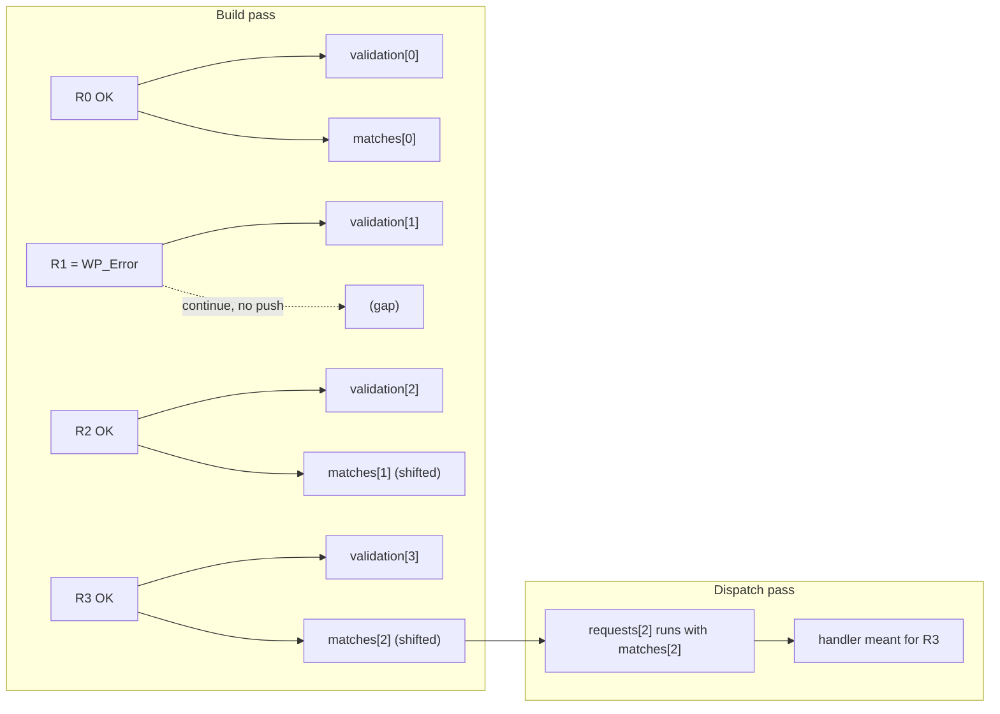
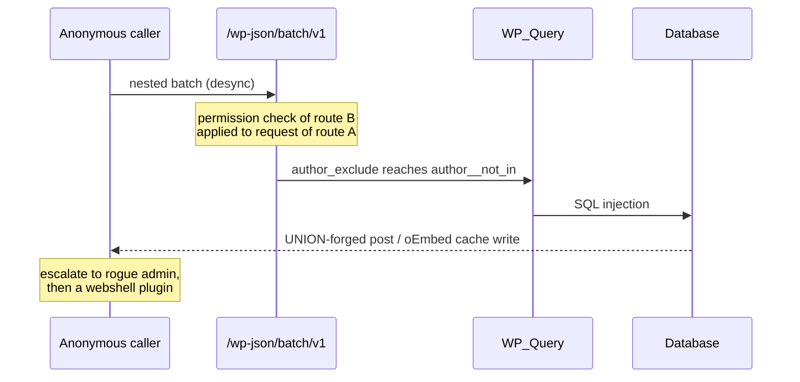
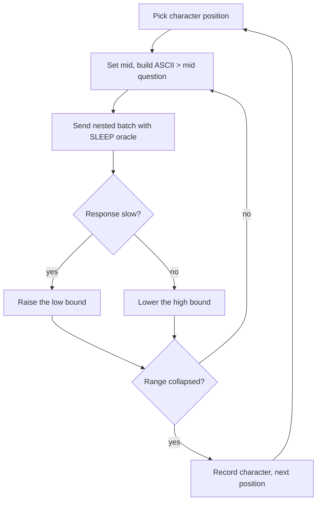

I keep a private rule for rating WordPress bugs: if it needs a plugin, I lower the urgency. wp2shell breaks that rule. It is WordPress itself, on a stock install, with no login. Two defects that look almost harmless alone. Together they walk an anonymous caller to a rogue admin and a webshell plugin.

Disclosed and patched on 17 July 2026. Public PoCs within hours. Multiple firms, including Hexastrike and Patchstack, confirmed exploitation in the days that followed. WordPress.org forced automatic updates across its supported install base, which almost certainly saved a huge share of the roughly two hundred million live sites. Almost certainly is not the same as verified on your host.

## Severity, scored carefully

| CVE | What it is | CVSS (Tenable / WPScan) | CISA ADP |
|---|---|---|---|
| CVE-2026-63030 | REST batch route confusion | 9.8 | 7.5 |
| CVE-2026-60137 | `author__not_in` SQL injection | 5.9 | 9.1 |

Sources disagree on the individual scores. "9.8 for the chain" is a useful shorthand, not an official number. I quote both.

Version split matters just as much:

| Branch | Exposure | Fixed in |
|---|---|---|
| 6.8.0 to 6.8.5 | SQLi only (no RCE path) | 6.8.6 |
| 6.9.0 to 6.9.4 | full unauthenticated RCE | 6.9.5 |
| 7.0.0 to 7.0.1 | full unauthenticated RCE | 7.0.2 |

CVE-2026-63030 arrived with WordPress 6.9. That is why older 6.8 installs get the injection but not the chain. Cloudflare also notes that the RCE path needs the site not to use a persistent external object cache such as Redis or Memcached. Millions of stock installs never touch one.

## Bug one: two arrays that fall out of step

WordPress has a REST API. A single HTTP call can carry several "sub-requests" inside it, through `POST /wp-json/batch/v1` (or `?rest_route=/batch/v1`). The server is supposed to validate each one, check its permissions, then run it.

The handler, `serve_batch_request_v1()`, builds two arrays in a first pass and consumes them in a second. One array (`$validation`) is pushed on every iteration. The other (`$matches`, which holds the route and permission handler) is pushed only for sub-requests that parse cleanly. An error path does `continue` without pushing to `$matches`. That is the whole bug.



From the first error onward, every later request is paired with the wrong handler. The request object was validated against route A. It is dispatched with the callback and permission check of route B.

A reconstruction from the 7.0.1 to 7.0.2 diff, with my annotations (not a weaponised payload):

```php
foreach ( $requests as $single_request ) {
    if ( is_wp_error( $single_request ) ) {
        $validation[] = $single_request;  // always push
        continue;                         // $matches gets NOTHING  <-- the bug
    }
    $matches[] = $this->match_request_to_handler( $single_request );
    $validation[] = /* ok or error */;
}
// later, dispatch reads $matches[ $i ] by the request index
// after the first error, $i no longer lines up with $matches
```

The educational shape of a desyncing batch (paths shortened):

```json
{
  "validation": "normal",
  "requests": [
    { "method": "POST", "path": "http://:" },
    { "method": "POST", "path": "<request you want executed>" },
    { "method": "POST", "path": "<route whose handler gets borrowed>" }
  ]
}
```

Index 0 fails to parse and becomes the error that shifts everything. Index 1 then runs under the route and permissions resolved for index 2. Nesting two batches is how the public analyses say you also dodge the "no GET inside a batch" schema rule, but the idea stays the same: the permission check that runs is not the one that belongs to the request being executed.

## Bug two: a parameter that never gets cleaned

Once you can reach a posts collection handler without its own permission check, you can send query parameters that handler understands. One of them is `author_exclude`. It maps into `WP_Query` as `author__not_in`, which is meant to be a list of user IDs to skip.

The sink never ran `array_map( 'absint', ... )` on that list. Unsanitised input reaches the SQL. That is CVE-2026-60137: a classical SQL injection, discovered by TF1T, dtro and haongo. Alone, behind an authenticated or restricted route, it is a 5.9. Reached anonymously through the desync, it is the next hop.



Eye Security's IR guide describes the finish: a UNION-forged post plus an oEmbed cache write produces a rogue administrator, then a webshell plugin. A full run is a dozen to dozens of requests. The decisive steps live inside POST bodies.


The entry point shows up as `POST /wp-json/batch/v1` (often HTTP 207). The injection itself does not. Eye's point is blunt: the database is the primary evidence, not the access log. Absence of log lines is not evidence of safety.


## The part I ran myself

Finding the two bugs is one thing. Reading real data out of them is the part that produced my findings, and it is worth showing how, without handing anyone a finished weapon.

The move is what I think of as REST parameter smuggling. The batch endpoint from Bug one lets me reach the posts handler without its own permission check. Once I am there I attach a query parameter that handler trusts, `author_exclude`, and ride my own SQL into it. The validation that should have rejected that input belongs to a different route, so my fragment slips past it. Smuggling, not breaking in.

The injected request is a batch nested inside a batch. Here is the shape, with the SQL reduced to a single placeholder. This is an illustration of where the pieces go, not a runnable tool.

```json
{
  "requests": [
    { "method": "POST", "path": "http://:" },          // index 0 fails to parse and starts the desync
    { "method": "POST", "path": "/wp/v2/posts", "body": {
        "requests": [
          { "method": "GET", "path": "http://:" },        // inner desync, also dodges the no-GET-in-batch rule
          { "method": "GET", "path": "/wp/v2/categories?author_exclude=<ORACLE>" },  // <-- injection point
          { "method": "GET", "path": "/wp/v2/posts" }
        ]
    }},
    { "method": "POST", "path": "/batch/v1" }
  ]
}
```

`<ORACLE>` is one boolean question dressed as SQL, shaped like `SELECT IF((<question>), SLEEP(1), 0)`. If the question is true the database sleeps for a second before it answers. If it is false the reply comes back fast. The response body never carries the data. The clock does. That is a blind, time-based oracle.

From one yes or no question you read a whole value by asking the right ones. I want the character at some position, so I binary-search its ASCII code. Is it above 79? Yes. Above 111? No. Each probe halves the range, so about seven probes pin one character.

```text
# oracle(expr) returns True when the page came back slow
lo, hi = 32, 126                       # printable ASCII range
while lo < hi:
    mid = (lo + hi) // 2
    if oracle("ASCII(SUBSTRING(value, pos, 1)) > " + mid):
        lo = mid + 1                   # real char sits higher
    else:
        hi = mid                       # real char is here or lower
# lo is now the character code at pos
```

Loop that over positions and you spell out a value one character at a time.



What I am leaving out is the rest of the machine: the HTTP client, the calibration step that learns what slow means on a given host, and the wiring that walks `wp_users` to dump a username and a password hash end to end. That glue is what turns this into point-and-shoot, and it teaches nothing the shape above does not.

A real run is slow and loud. Every character is several requests, every value is dozens to hundreds of them, and all of it lands on the same endpoint from the same source. It works. It is not quiet.


I ran this only against systems I was authorised to assess, and the chain is patched. Showing the request shape and the oracle idea is the useful part. Shipping the finished dumper is not, so I am not doing it.


## What I'd pull if I were on the box

Eye's compromise scanner looks for these traces. Match on prefixes, not exact strings, because the public PoCs pick a prefix plus a random suffix.

| Type | Look for |
|---|---|
| Rogue admin login | `wp2_*`, `w2s_*` |
| Rogue admin email | `@wp2shell.invalid`, `@wp2shell.shellcode.lol` |
| Endpoint | `/wp-json/batch/v1`, `?rest_route=/batch/v1` |
| Database | oEmbed cache loopback rows, `customize_changeset` with very high parent IDs, orphaned usermeta, user-ID gaps |

Filesystem next. Recently created PHP under the web root. New plugins. Crontabs for `www-data`. Auth log for shells spawned by the web user. Dump `wp_users` and `wp_usermeta` from a copy, not the live DB. Force a password reset for every account even on SQLi-only 6.8 sites: the injection can read the hashes.

## Detection without depending on the body

```text
RULE wp_batch_unauth_burst
  WHEN method = POST
   AND (uri contains "/wp-json/batch/v1"
        OR query contains "rest_route=/batch/v1")
   AND status IN (200, 207)
   AND user is anonymous
   AND count by src_ip over 10 minutes >= N
  -> MEDIUM

RULE new_admin_after_batch
  WHEN WordPress admin user created
   AND login matches /^(wp2_|w2s_)/
    OR email domain in (wp2shell.invalid, wp2shell.shellcode.lol)
   AND within 1 hour of a batch rule hit from same src
  -> HIGH

RULE web_user_spawns_shell
  WHEN process user IN (www-data, nginx, apache)
   AND process.name IN (sh, bash, php)
   AND parent is php-fpm or apache
  -> HIGH
```

Elastic Defend published a write-up on detecting the RCE stage. F5 Labs published a captured payload. Both are worth feeding into the content pipeline, but the three rules above already cover the shape without needing a signature for today's PoC.

## The one-line fix that closed it



```php
// error branch: push validation, skip matches
if ( is_wp_error( $single_request ) ) {
    $validation[] = $single_request;
    continue;   // $matches drifts
}
// SQLi sink
$author__not_in = $raw_list;   // no absint
```


```php
// keep the two arrays the same length
$matches[] = /* error placeholder or real match */;
// and on the SQLi sink
$author__not_in = array_map( 'absint', $raw_list );
// WordPress also landed wp_parse_id_list() hardening in 7.0.2
```



Until you can patch: block anonymous access to the batch endpoint at the WAF, covering both `/wp-json/batch/v1` and `?rest_route=/batch/v1`. Searchlight published a tiny plugin that does the same. None of those replace the update.

## Why this one stays on my board

Two missing lines. One `continue` that forgot to push. One `absint` that never ran. Separately, a curious edge case and a middling SQLi. Together, pre-auth RCE on the most deployed CMS on the internet.

This one is also personal. The 2 valid findings I got here came out of exactly the oracle loop above, which is a big part of why I keep it on my board.

The lesson I take to detection work is about composition. A low-severity finding next to a logic bug in the same feature is often the real story. Score them alone and you will schedule them for next quarter. Score the chain and you patch tonight.

## Sources

- Searchlight Cyber / wp2shell.com: https://wp2shell.com/
- Searchlight research page: https://www.slcyber.io/research/wp2shell-pre-authentication-rce-in-wordpress-core
- Tenable FAQ (CVSS table, versions, exploitation): https://www.tenable.com/blog/wp2shell-cve-2026-63030-cve-2026-60137-frequently-asked-questions-about-remote-code-execution
- Eye Security IR guide (artifacts, log-blind chain): https://research.eye.security/wp2shell-defenders-guide/
- Elastic Security Labs: https://www.elastic.co/security-labs/blog/wp2shell-wordpress-rce-detection-elastic-defend
- F5 Labs captured payload: https://www.f5.com/labs/articles/cve-2026-63030-and-cve-2026-60137-wp2shell-captured-exploit-payload
- GHSA-ff9f-jf42-662q (CVE-2026-63030) and GHSA-fpp7-x2x2-2mjf (CVE-2026-60137)
- Mechanism write-ups used for the desync diagram: https://www.christbowel.com/blog/wp2shell/ and https://zenithgenius.github.io/wordpress-batch-rce-lab/analysis/mechanism.html
