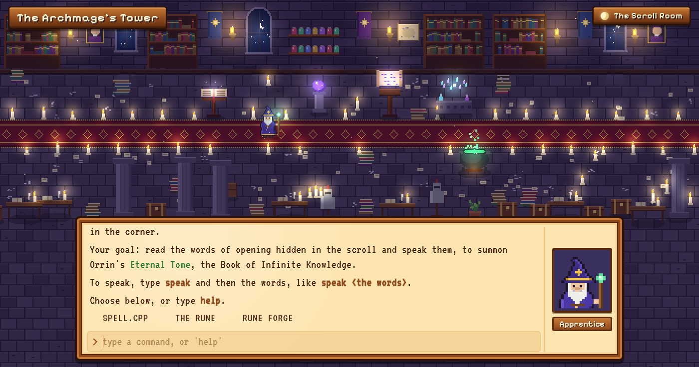
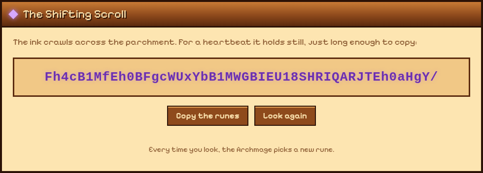
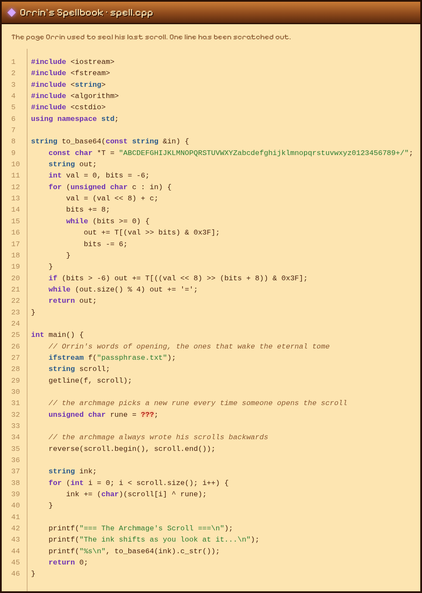
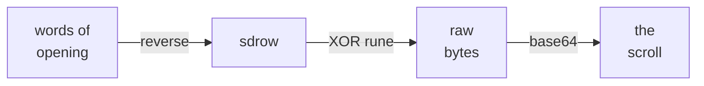
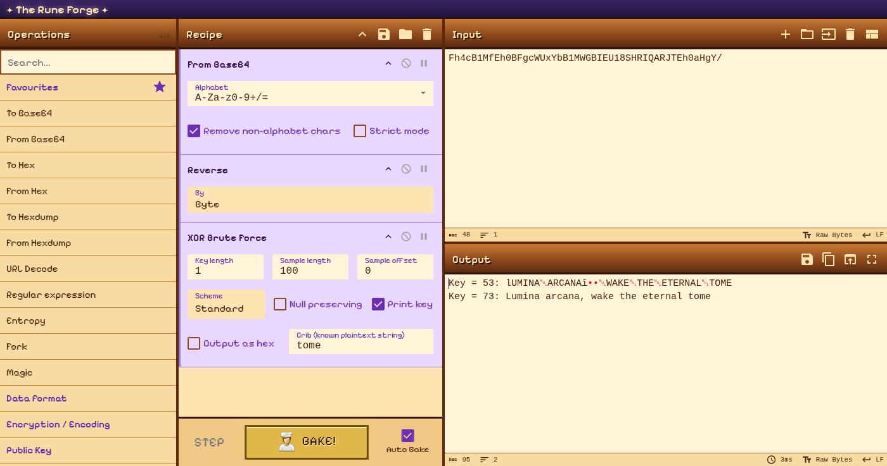
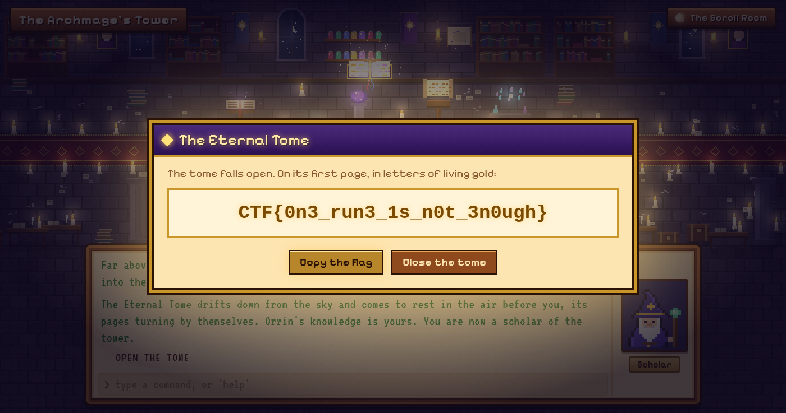
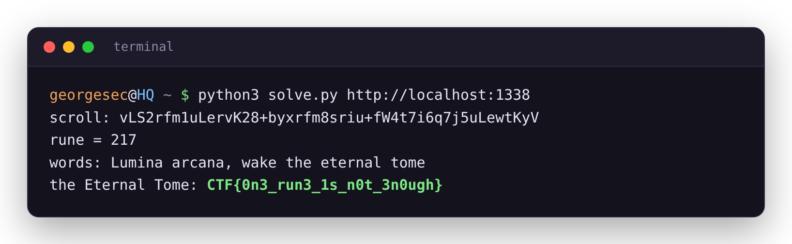

The Cadmus Student CTF was a capture-the-flag competition for students, held on 17 November 2026 at the [ICT Academy](https://ictacademy.cy/academy/) in Cyprus. The [Digital Security Authority](https://dsa.cy/en/) and the [Cyprus Computer Society](https://ccs.org.cy/en/) ran it as part of the EU-funded [CADMUS project](https://cadmus-project.eu), and I wrote three of its challenges, each one a small pixel-art game. This post covers **The Archmage's Scroll**, the crypto one. You don't need to have played it. I'll walk through what's on screen, what the code does, and why the "encryption" falls apart. The other two writeups are [Spell Command](/projects/cadmus-ctf-2026-spell-command/) (web) and [The Enchanted Prison](/projects/cadmus-ctf-2026-enchanted-prison/) (misc).

| Challenge | The Archmage's Scroll |
|---|---|
| **Category** | Crypto |
| **Difficulty** | Easy |
| **Skills** | Reading a short C++ program, base64, XOR, brute force, CyberChef |
| **Flag** | `CTF{0n3_run3_1s_n0t_3n0ugh}` |

## The story

You've climbed to the top of the old Archmage Orrin's tower. His last scroll floats above the lectern, written in gibberish. Next to it, his spellbook lies open on the exact spell he used to seal it. Read what the scroll really says, **speak** it, and the Eternal Tome (the Book of Infinite Knowledge) comes down from the sky and opens on the flag.

The description gives away the core idea: *"he locks the whole thing with just one rune, and he picks a new one every time someone looks at it... how many runes can there be?"*



The game gives you three things to look at:

- **SPELL.CPP** opens Orrin's spellbook: the program that seals the scroll.
- **THE RUNE** opens the sealed scroll itself.
- **RUNE FORGE** opens a copy of [CyberChef](https://gchq.github.io/CyberChef/) dressed up in the tower's colours. It's GCHQ's free "cyber Swiss army knife" for encoding, decoding and simple crypto.

## The scroll



The scroll is a line of letters, digits, `+` and `/`. If you've seen it before, that's **base64**: a way to write raw bytes using only 64 printable characters. Base64 hides nothing. It only makes binary data safe to copy and paste.

Press **Look again** and the text changes completely, even though the message behind it is always the same. That's the "new rune every time".

## The spell



The base64 function at the top is just a helper. The interesting part is `main()`. Here it is in plain words:

```cpp
getline(f, scroll);                       // 1. read the secret words
unsigned char rune = ???;                 // 2. pick a key: ONE byte, scratched out
reverse(scroll.begin(), scroll.end());    // 3. write them backwards
for (...) ink += scroll[i] ^ rune;        // 4. XOR every letter with the same key
printf("%s\n", to_base64(ink).c_str());   // 5. print it as base64
```



To read the scroll, we run those steps backwards: **base64 decode → reverse → XOR with the rune**. The only thing we don't know is the rune.

## XOR in one minute

XOR (`^`) compares two bits: the result is 1 when they differ, 0 when they match. Do it on every bit of a letter and a key, and you get a scrambled byte:

```
'L'        0100 1100
rune 217   1101 1001
           ---------  XOR
result     1001 0101   (0x95, no longer a letter)
```

XOR has one magic property: doing it twice with the same key gives you back what you started with (`x ^ k ^ k = x`). That's why the same operation both locks and unlocks.

## Why one rune is not enough

Look at the type: `unsigned char rune`. An `unsigned char` is **one byte**, so there are only 256 possible values, and 0 does nothing at all. Picking a new rune every time sounds clever, but every single scroll can be unlocked by simply trying all 255 runes and keeping the one that turns into readable English. Trying every key like that is called **brute force**, and with 255 keys a computer finishes before you can blink.


A key you change every time doesn't help if the key space is tiny. Real ciphers use keys of 128 bits or more: that's 2¹²⁸ options instead of 2⁸.


## Solving it with no code (CyberChef)

1. **THE RUNE → Copy the runes.**
2. **RUNE FORGE**: paste it into *Input*.
3. Add **From Base64**.
4. Add **Reverse**, and set *By* to **Byte**. The default, *Character*, can mangle raw bytes that aren't valid text.
5. Add **XOR Brute Force**. It tries every key and prints one line per key. Set *Crib* to a word you expect in the answer, for example `tome` (the story keeps talking about the Eternal Tome), and CyberChef only shows the lines that contain it.



Two lines survive the crib, and that's worth understanding. In ASCII, upper- and lower-case letters differ by exactly one bit (`0x20`). So a key that is `0x20` away from the real one flips the case of every letter. It also turns spaces into nulls and mangles the comma. Only one line reads like a sentence:

```
lUMINA␀ARCANA␌␀WAKE␀THE␀ETERNAL␀TOME   <- case-flipped twin
Lumina arcana, wake the eternal tome    <- the real words
```

The key numbers you see change from scroll to scroll. The words never do.

## Speaking the words

Back in the tower, type:

```
speak Lumina arcana, wake the eternal tome
```

The scroll freezes, the Eternal Tome drifts down from the sky in a beam of light, and it falls open on the flag.



**Flag:** `CTF{0n3_run3_1s_n0t_3n0ugh}`

If you close the tome, typing `flag` opens it again. Anyone who hasn't spoken the words yet is told they have no scholar privileges.


The flag is never in the page or in the scroll. The server only sends it as the reply to the correct words, so reading the page source gets you nothing.


## Solving it with a few lines of Python

The same idea as a script: grab a scroll, undo the steps, try every rune, keep the one that looks like a sentence, and speak it.

```python
import base64, re, requests

url = "http://localhost:1338"
runes = re.search(r'id="runes">\s*([A-Za-z0-9+/=]+)\s*<', requests.get(url + "/scroll/").text).group(1)

ink = base64.b64decode(runes)[::-1]               # base64 decode, then reverse
for rune in range(1, 256):                        # only 255 keys to try
    words = bytes(b ^ rune for b in ink)
    if re.fullmatch(rb"[A-Z][a-z ,]+", words):    # a capital, then plain lowercase text
        break

print(rune, words.decode())
print(requests.post(url + "/api/speak", json={"words": words.decode()}).json()["flag"])
```



## What Orrin should have known

- **Encoding is not encryption.** Base64 and reversing the text only make it *look* scrambled.
- **XOR with a short key is weak, and a one-byte key is nothing.** The size of the key space is what matters, not how often you change the key.
- **Knowing roughly what the answer looks like is a weapon.** "It's an English sentence" or "it contains `tome`" is enough to pick the right key out of 255. That's called a *crib*, and it's how many real codes were broken.
- **Watch for near-misses.** The case-flipped twin is a nice reminder that brute force output still needs a human to check it.

## A side note: traps for AI

As in the other two games, I planted decoys that only an AI model would ever see: fake pages served to known AI fetchers, and notes hidden from people (CSS, invisible Unicode "tag" characters that survive copy-paste) that point at fake words, a fake rune and a fake flag. A player using a browser, CyberChef or their own script never touches any of it.

## Sources

- CyberChef: https://gchq.github.io/CyberChef/
- RFC 4648, the Base64 encoding: https://www.rfc-editor.org/rfc/rfc4648
- XOR cipher (Wikipedia): https://en.wikipedia.org/wiki/XOR_cipher
- Known-plaintext attack and cribs (Wikipedia): https://en.wikipedia.org/wiki/Known-plaintext_attack
