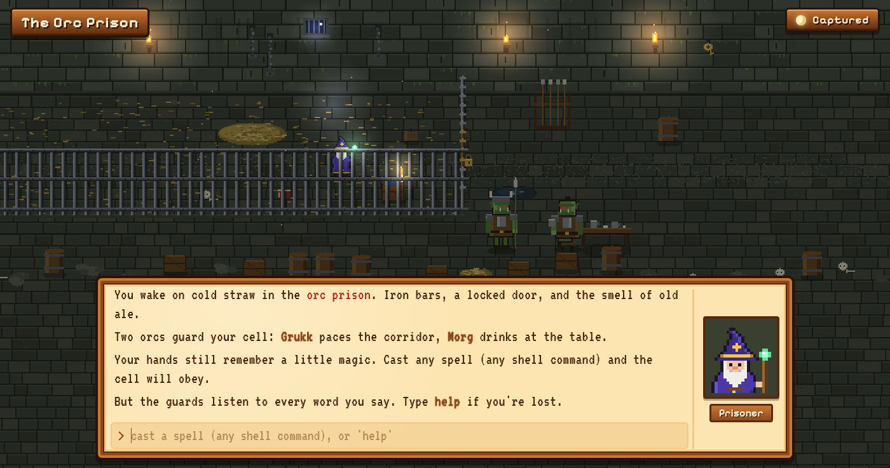
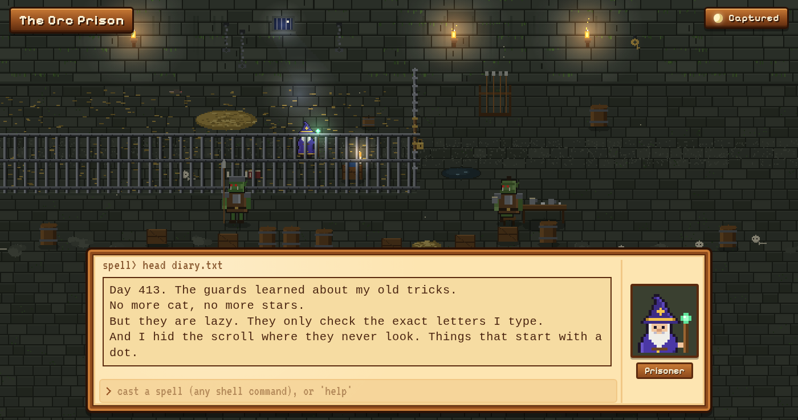
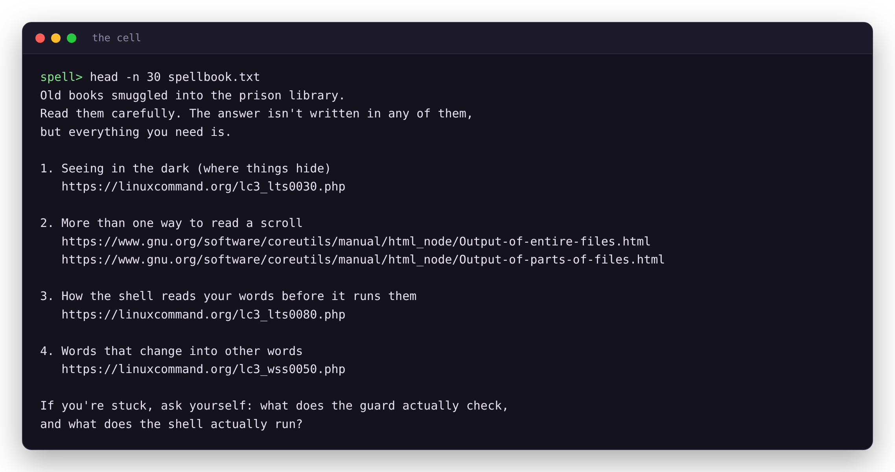
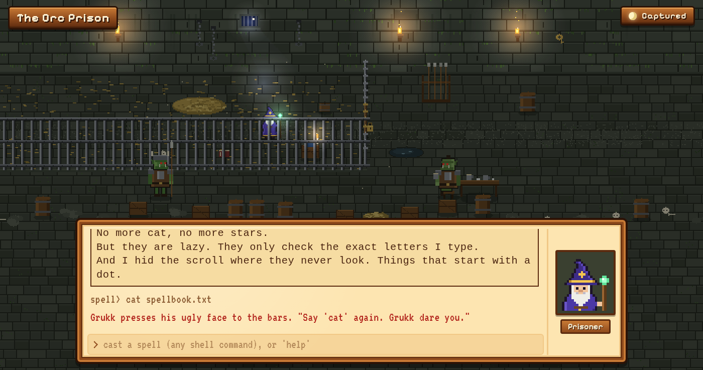
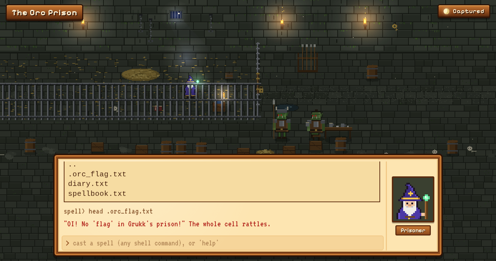
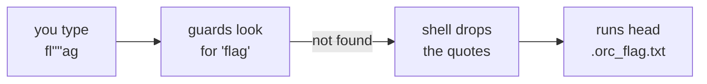
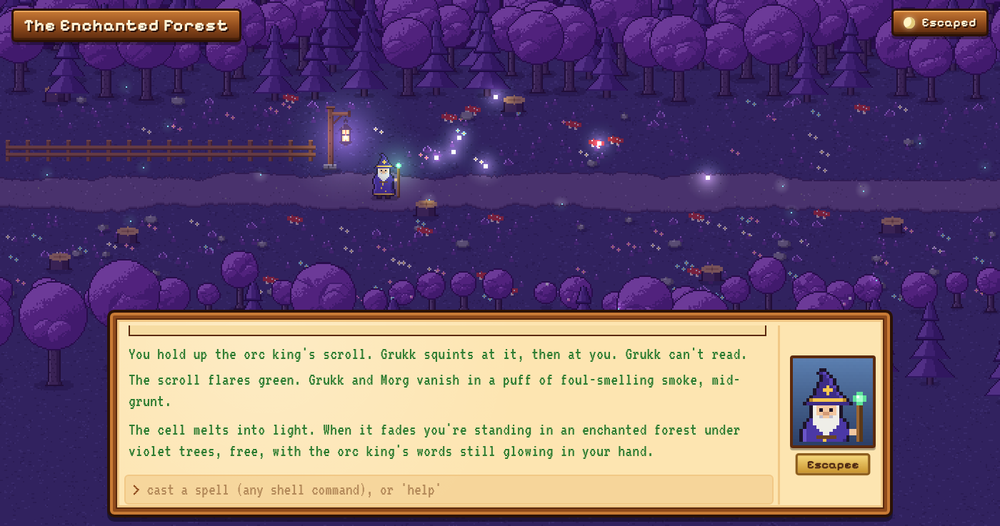
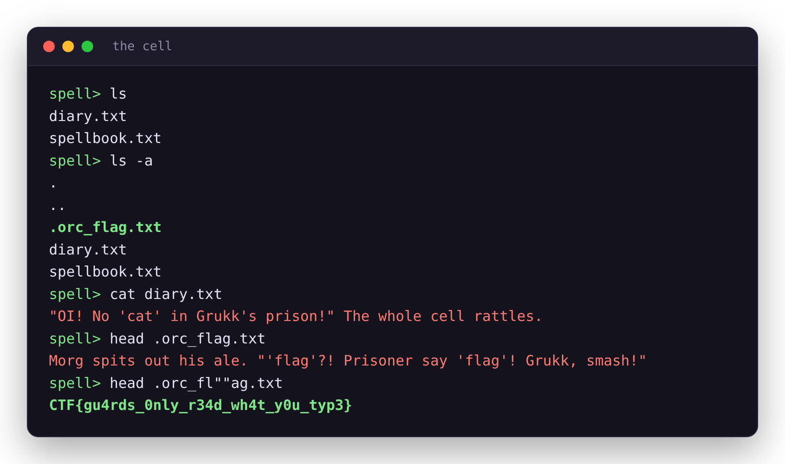

On 17 November 2026 students in Cyprus met at the [ICT Academy](https://ictacademy.cy/academy/) for the Cadmus Student CTF, a capture-the-flag competition organised by the [Digital Security Authority](https://dsa.cy/en/) and the [Cyprus Computer Society](https://ccs.org.cy/en/) as part of the EU-funded [CADMUS project](https://cadmus-project.eu). Three of its challenges were mine, all small pixel-art games. This post covers **The Enchanted Prison**, the misc one: a small Linux "jail". You don't need to know Linux well to follow along. I'll explain each command as it comes up. The other two writeups are [Spell Command](/projects/cadmus-ctf-2026-spell-command/) (web) and [The Archmage's Scroll](/projects/cadmus-ctf-2026-archmage-scroll/) (crypto).

| Challenge | The Enchanted Prison |
|---|---|
| **Category** | Misc |
| **Difficulty** | Easy |
| **Skills** | Basic Linux commands, hidden files, how the shell reads a command line |
| **Flag** | `CTF{gu4rds_0nly_r34d_wh4t_y0u_typ3}` |

## The story

The orc king threw you in his prison for asking too many questions. Your cell is magic: it does anything you tell it. Every line you type is run as a real **shell command** inside the cell. But two orc guards, Grukk and Morg, listen to every word first, and some words make them very angry.

Your goal is to read the orc king's scroll.



## What is a "shell jail"?

A **shell** is the program that reads the commands you type in a Linux terminal (`ls`, `cat`, …) and runs them. A **jail** challenge gives you a shell with restrictions, here a list of forbidden words, and asks you to get around them.

The guards never show you their list. You find it by trying things, because when they catch a word, they yell it back at you:

| Forbidden | Why it's on the list |
|---|---|
| `cat` | the usual way to print a file |
| `flag`, `CTF` | the obvious words to search for |
| `*`, `?`, `[` | wildcards: `*` matches any file name |
| `-r`, `-R` | "recursive", e.g. `grep -r` to search every file at once |
| `\` and `` ` `` | escape tricks and an old way to run a command inside a command |

## Step 1: look around

`ls` lists the files in the current folder. There are two:

```
spell> ls
diary.txt
spellbook.txt
```

They're notes left by prisoners before you, and the first hint on the challenge page says to read them first. `cat` is the usual way to print a file, but it's forbidden, so we use `head`, which prints the first lines of a file. (More on that below.)



The diary tells you **what** to do:

> *Day 413. The guards learned about my old tricks. No more cat, no more stars. But they are lazy. They only check the exact letters I type. And I hid the scroll where they never look. Things that start with a dot.*

The spellbook tells you **how**. It's a reading list left by an earlier prisoner:



It never gives the answer away, but each entry teaches one step of the escape, in the order you need them:

| Spellbook entry | Where the link goes | What it unlocks |
|---|---|---|
| 1. Seeing in the dark (where things hide) | [Looking Around](https://linuxcommand.org/lc3_lts0030.php), the `ls` lesson | Hidden dot-files and `ls -a`. That's how you find the scroll (step 3). |
| 2. More than one way to read a scroll | GNU coreutils: [Output of entire files](https://www.gnu.org/software/coreutils/manual/html_node/Output-of-entire-files.html) and [Output of parts of files](https://www.gnu.org/software/coreutils/manual/html_node/Output-of-parts-of-files.html) | Every command besides `cat` that prints a file: `tac`, `nl`, `head`, `tail`… That gets you around the `cat` ban. |
| 3. How the shell reads your words before it runs them | [Expansion](https://linuxcommand.org/lc3_lts0080.php), with its section on **quoting** | The shell rewrites your line before running it, so `fl""ag` turns back into `flag` (step 4). |
| 4. Words that change into other words | [Command Substitution and Constants](https://linuxcommand.org/lc3_wss0050.php) | Building the forbidden word with `$( )` or variables, so you never type it ("Other ways out"). |

Its last line is the question the whole challenge rests on: *what does the guard actually check, and what does the shell actually run?* Keep it in mind for step 4.

## Step 2: the guards in action

Try `cat`, and Grukk loses it:



## Step 3: things that start with a dot

On Linux, any file whose name starts with a dot is **hidden**. Plain `ls` skips it, and `ls -a` ("all") shows it:



There's the scroll: `.orc_flag.txt`. But its name contains `flag`, so even `head .orc_flag.txt` gets us yelled at. We can't type the file's name.

## Step 4: the guards read text, the shell reads meaning

This is the heart of the challenge. When you press Enter, two different things look at your line:

1. **The guards** read the raw text, character by character, and look for forbidden words.
2. **The shell** then *rewrites* your line before running it. It removes quotes, swaps variables for their values, runs commands inside `$( )` and pastes in their output, and so on.

So if we write the forbidden word in a way the shell will **rebuild**, the guards never see it, and the shell runs it anyway. The simplest way is an empty pair of quotes in the middle of the word:

```
spell> head .orc_fl""ag.txt
CTF{gu4rds_0nly_r34d_wh4t_y0u_typ3}
```



To the guards, `fl""ag` is not `flag`. To the shell, `""` is an empty string glued between `fl` and `ag`, so the shell builds `flag` itself. The moment the scroll is read, the orcs vanish in green smoke and you're teleported out.



The whole escape in one terminal:



**Flag:** `CTF{gu4rds_0nly_r34d_wh4t_y0u_typ3}`

## Other ways out

Any trick that makes the **shell** build the forbidden word works, because the guards only ever see what you typed:

| Spell | Why it works |
|---|---|
| `head .orc_fl""ag.txt` | the shell deletes the empty quotes |
| `head .orc_fl''ag.txt` | same thing, single quotes |
| `a=fl; b=ag; tac .orc_$a$b.txt` | variables: the shell glues `fl` + `ag` together after the check |
| `tac $(ls -a \| grep orc)` | command substitution: `ls` finds the name for you, and you never type it |
| `ls -a \| xargs head` | `xargs` passes every file name, including the hidden one, to `head` |

There are also many ways to read a file without `cat`: `head`, `tail`, `tac` (cat backwards), `nl` (with line numbers), `more`, `sed ''`, `grep '' file`… The spellbook's second link is the GNU coreutils page that lists most of them.

## What doesn't work, and why

The obvious "real hacker" move is to start a fresh shell (`sh`, `bash`, `exec sh`) and type freely in it, since nobody's checking there. It does nothing here. Each spell runs on its own, with no keyboard attached (its input is `/dev/null`) and its output going straight back to the game, so a new shell has nothing to read and exits immediately.

The cell is also locked down so one prisoner can't ruin it for others: it's read-only, and every spell has limits (10 seconds, small files, a cap on processes and memory). The game still lets you run almost anything, which is the point: the escape is about understanding the shell, not breaking the box.

## Why the guards were always going to lose

- **Hidden files exist.** `ls -a` should be a reflex.
- **There's never only one way to do something on Linux.** Blocking `cat` blocks one command out of dozens.
- **Filters that check text are weak.** The guards check what you *typed*. The shell runs what it *built* from it. Blocklists in real software break the same way, which is why good defences use allowlists or check the final result instead of the input.

## A side note: traps for AI

As in the other two games, the description, the in-game text and both prison books carry notes hidden from people (CSS and invisible Unicode "tag" characters that survive copy-paste), and known AI fetchers get a decoy site. The notes send an AI after a file that doesn't exist and a fake flag. Players reading the books in the game never see any of it.

## Sources

- The Linux Command Line, Looking Around: https://linuxcommand.org/lc3_lts0030.php
- The Linux Command Line, Expansion: https://linuxcommand.org/lc3_lts0080.php
- Writing Shell Scripts, Command Substitution and Constants: https://linuxcommand.org/lc3_wss0050.php
- GNU coreutils, Output of entire files: https://www.gnu.org/software/coreutils/manual/html_node/Output-of-entire-files.html
- GNU coreutils, Output of parts of files: https://www.gnu.org/software/coreutils/manual/html_node/Output-of-parts-of-files.html
- GNU Bash manual, Quote Removal: https://www.gnu.org/software/bash/manual/html_node/Quote-Removal.html
