I wrote three challenges for the Cadmus Student CTF, a capture-the-flag competition for students held on 17 November 2026 at the [ICT Academy](https://ictacademy.cy/academy/) in Cyprus. It was organised by the [Digital Security Authority](https://dsa.cy/en/) and the [Cyprus Computer Society](https://ccs.org.cy/en/) as part of the EU-funded [CADMUS project](https://cadmus-project.eu). All three challenges are small pixel-art games. This post covers **Spell Command**, the web one. You don't need to have played it. I'll show every screen and explain each idea as it comes up. The other two writeups are [The Archmage's Scroll](/projects/cadmus-ctf-2026-archmage-scroll/) (crypto) and [The Enchanted Prison](/projects/cadmus-ctf-2026-enchanted-prison/) (misc).

| Challenge | Spell Command |
|---|---|
| **Category** | Web |
| **Difficulty** | Easy |
| **Skills** | Reading what the browser downloads, `robots.txt`, `security.txt`, base64, Unicode |
| **Flag** | `CTF{th3_f0r3st_wh1sp3rs_1ts_s3cr3ts}` |


One idea in this challenge comes from Hack The Box's [Flag Command](https://github.com/hackthebox/cyber-apocalypse-2024/tree/main/web) (Cyber Apocalypse 2024, web, very easy): a plain text game whose choices come from an `/api/options` endpoint that hands the client every possible command. I liked that a lot, so I built my opening on it. Everything else is my own: the pixel-art game itself, the forest, the story and its chapters, and every clue after the first one (the whisper, the journal, `security.txt`, the double base64, the hidden page and the Unicode words).


## The story

The forest of Eldergrove is dying. The Archmage Orrin is gone, and you are his last apprentice. Only the Heartwood, the great tree in the middle of the forest, can save it, and it only wakes for someone who speaks *the old words*. Nobody remembers them.

The challenge description ends with a nudge: *"stop looking at the trees and look at what's behind them."* In web terms, that means stop playing the game and look at what the page is doing behind the scenes.

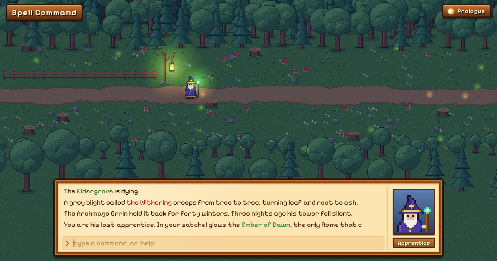

## Playing it the honest way

Type `start` and the game gives you four choices per chapter. Pick one by typing it.

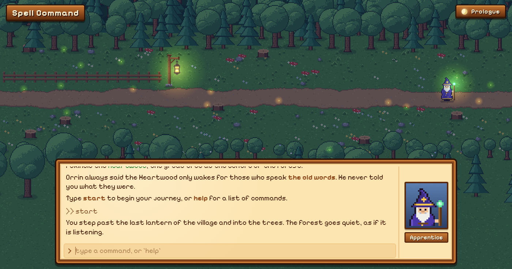

The first three chapters each have exactly one safe choice. The fourth chapter, at the Heartwood itself, has four choices and **every single one of them kills you**.

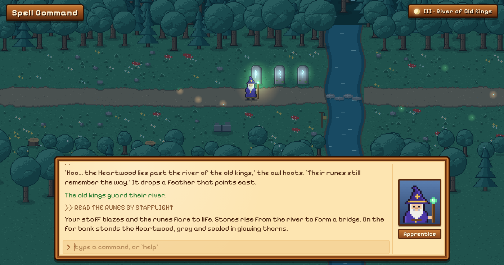

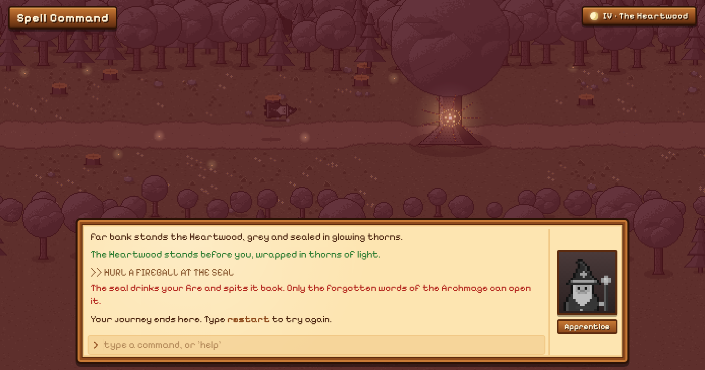

That's the first lesson of the challenge: you can't win by playing. The death message even says so: *"Only the forgotten words of the Archmage can open it."* So we need to find words the game never shows us.

## Step 1: look at what the page downloads

A web page is just a program the server sends to your browser. Everything it shows has to arrive over the network first. Open the browser's developer tools (F12), go to the **Network** tab and reload. One request stands out: `/api/options`. The game calls it on load to learn which choices to show.

The game only ever shows you the `allPossibleCommands` list. The JSON contains one more key that the game never displays:

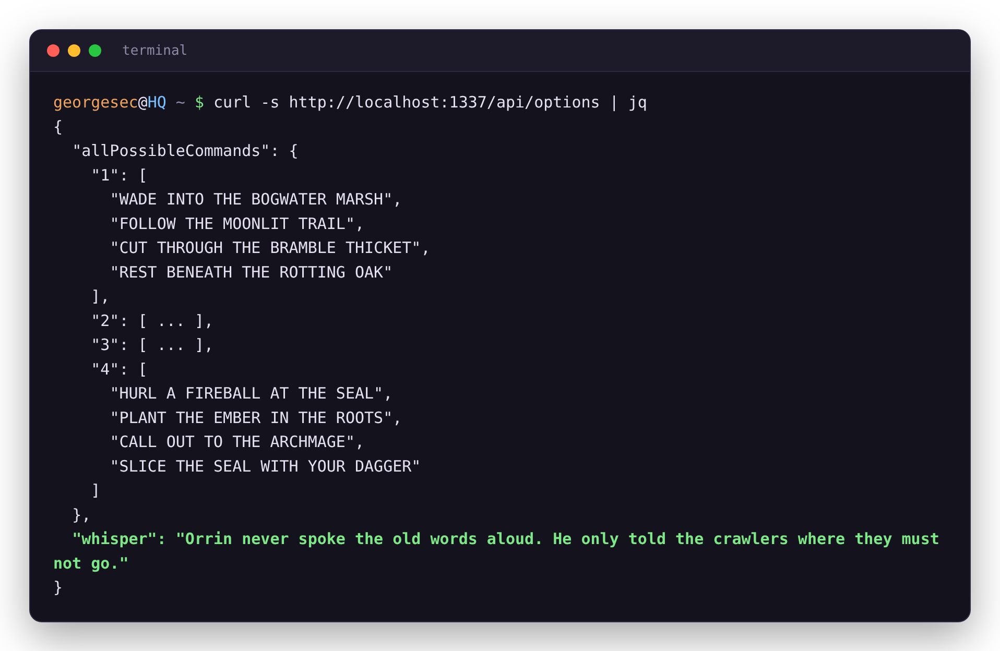

> *"Orrin never spoke the old words aloud. He only told the crawlers where they must not go."*

"Crawlers" means web crawlers: the bots search engines send out to index websites. And there is one standard place where a website tells crawlers where they must not go.


This is the same trick as HTB's Flag Command, where `/api/options` leaks a secret command. Here it leaks a hint instead, and the hunt starts from there.


## Step 2: `robots.txt`

Almost every website has a file at `/robots.txt`. It's a polite request to crawlers: "please don't index these paths". It doesn't stop anyone. In fact it does the opposite for curious people, because it is a public list of the places a site would rather you didn't look.

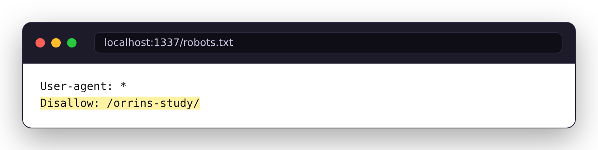

So we go exactly where we were told not to: `/orrins-study/`.

## Step 3: Orrin's journal

The study holds the last page of Orrin's journal.

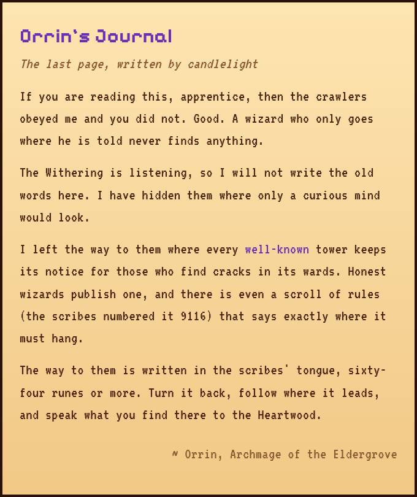

It's written as a riddle, so let's take it one line at a time:

- *"the crawlers obeyed me and you did not. Good."* We're on the right track.
- *"every **well-known** tower keeps its notice for those who find cracks in its wards"*. Websites publish a notice for people who find security holes ("cracks in its wards"). It lives under a folder literally called `/.well-known/`.
- *"a scroll of rules (the scribes numbered it **9116**)"*. A scroll of rules with a number is an **RFC**, the documents that define internet standards. [RFC 9116](https://www.rfc-editor.org/rfc/rfc9116) defines `security.txt`: a small file at `/.well-known/security.txt` that tells security researchers how to report a bug.
- *"written in the scribes' tongue, sixty-four runes **or more**"*. Sixty-four runes means **base64**. "Or more" warns you it's encoded more than once.
- *"Turn it back, follow where it leads"*. Decode it, and what you get is a place to visit, not the words themselves.

This is the step that needs a bit of research. If you've never heard of RFC 9116, searching "RFC 9116" gets you there in one click.

## Step 4: `security.txt`

The file looks like a real security policy, just in Orrin's voice. At the very bottom, behind a `#` comment, is the scroll.

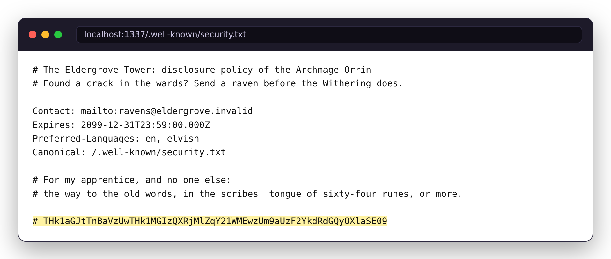

## Step 5: decode it (twice)

**Base64** is not encryption. It's a way to write any data using only 64 safe characters (A to Z, a to z, 0 to 9, `+` and `/`), so anyone can turn it back. Decode the scroll once and you get… more base64. That's the "or more". Decode it again:

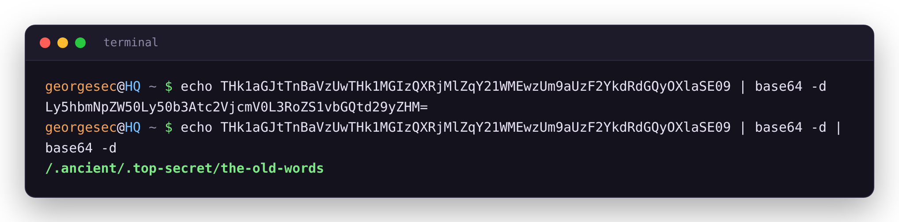

```bash
echo THk1aGJtTnBaVzUwTHk1MGIzQXRjMlZqY21WMEwzUm9aUzF2YkdRdGQyOXlaSE09 | base64 -d | base64 -d
# /.ancient/.top-secret/the-old-words
```

One gotcha: copy the text **without** the `# ` in front. In a shell, `#` starts a comment, so `echo # THk1...` prints nothing at all. [CyberChef](https://gchq.github.io/CyberChef/) with **From Base64** twice works too, and it ignores the `#` for you.

## Step 6: the old words

The path leads to one short page.

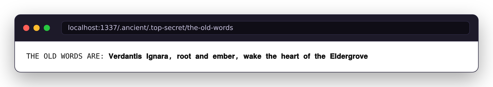

The words look **bold**, but not because of any styling. They're written with special Unicode characters from the *Mathematical Bold* block. `𝐕` is not the letter `V`, it's a completely different character that just looks like a bold V. I did this on purpose: if the server compared the text byte for byte, a player who typed the words by hand would fail, and a player who pasted them would pass, or the other way round.

So the server normalises what you type first (Unicode **NFKC**, which folds "fancy" lookalike letters back to plain ones) before it compares. All three of these work:

- typing the words normally: `Verdantis Ignara, root and ember, wake the heart of the Eldergrove`
- pasting the bold words as they are
- pasting the whole line, label included

## Step 7: wake the Heartwood

Back in the game, type the words at any point, even before `start`.

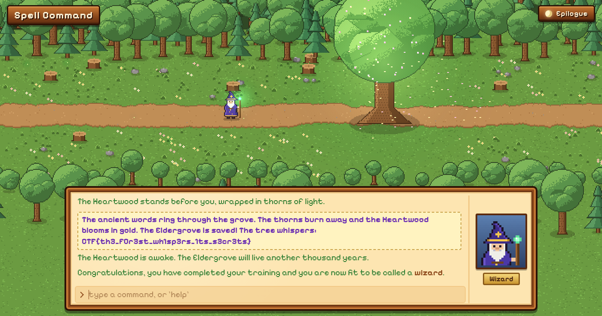

Or skip the game and talk to the API directly, the same way the game does:

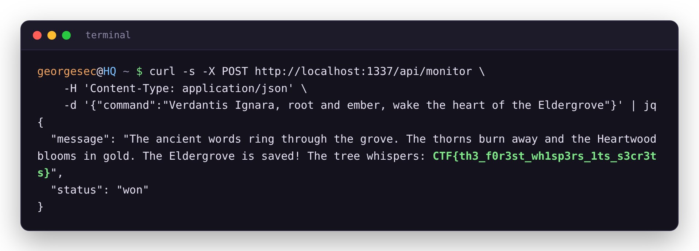

**Flag:** `CTF{th3_f0r3st_wh1sp3rs_1ts_s3cr3ts}`

## The whole path at a glance

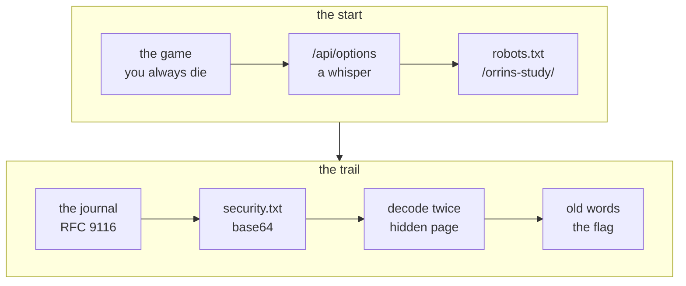

## What the forest was really teaching

- **The page you see is not the whole page.** Anything the browser receives, you can read. Hiding something in a JSON response the UI ignores is not hiding it.
- **`robots.txt` is a map, not a wall.** Real recon starts there for a reason.
- **`/.well-known/` and `security.txt` exist.** They're real standards, and real sites publish them.
- **Encoding is not encryption.** Base64 (even twice) protects nothing.
- **Text is trickier than it looks.** Two strings can look identical and be different bytes. Normalising input before comparing it matters, in CTFs and in real login forms.

## A side note: traps for AI

I didn't want a model to solve the whole thing from a pasted description, so I planted decoys for AI only. Known AI fetchers get a fake version of the site. The pages and the description carry hidden notes that people never see: some hidden with CSS, some written in invisible Unicode "tag" characters that survive copy-paste. Those notes point at fake words and a fake flag, and the game rejects the fake words with *"Those words were never Orrin's."* A human using a normal browser never runs into any of it, and the real path above is untouched.

## Sources

- Hack The Box, Flag Command (Cyber Apocalypse 2024), the text game that inspired the `/api/options` opening: https://github.com/hackthebox/cyber-apocalypse-2024/tree/main/web
- RFC 9116, A File Format to Aid in Security Vulnerability Disclosure (`security.txt`): https://www.rfc-editor.org/rfc/rfc9116
- Google Search Central, introduction to `robots.txt`: https://developers.google.com/search/docs/crawling-indexing/robots/intro
- RFC 4648, the Base64 encoding: https://www.rfc-editor.org/rfc/rfc4648
- Unicode Standard Annex #15, Unicode Normalization Forms (NFKC): https://unicode.org/reports/tr15/
- CyberChef: https://gchq.github.io/CyberChef/
